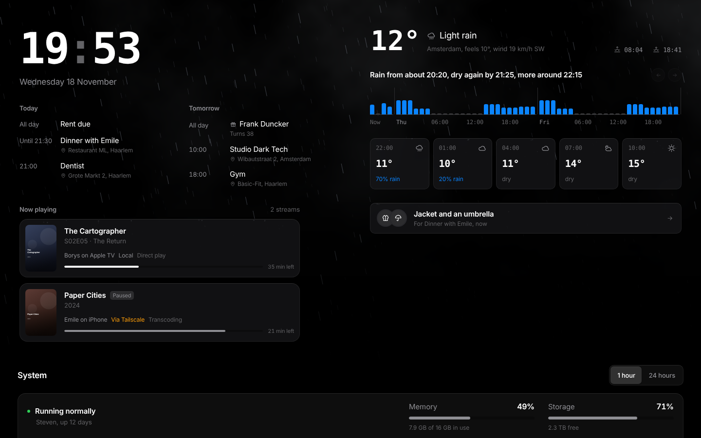

# home-dashboard



A dashboard for the screen at home: the time and today's agenda, the weather with a two-hour rain outlook and what to
wear when you go out, what's playing on Jellyfin, downloads, and the health of the NAS it runs on. A Vue frontend and
an Express backend, shipped as one Docker container on an Asustor NAS.

## Stack

| | |
|---|---|
| Frontend | Vue 3, Vue Router, Pinia, Tailwind CSS 3, Vite |
| Backend | Express, with `node-cache` in front of every upstream |
| Data | OpenWeather and Buienradar, iCloud CalDAV, Jellyfin, TMDB, Sonarr and Radarr, qBittorrent, NZBGet, Homebridge |
| NAS health | SNMP (`net-snmp`) for CPU, memory, disks and network; the Docker socket for containers |
| Hosting | Docker on the NAS; GitHub Actions builds the image from `main` |

## Getting started

```bash
cp .env.example .env
npm --prefix backend install
npm --prefix frontend install
npm --prefix backend run dev    # API on http://localhost:3001
npm --prefix frontend run dev   # dashboard
```

To see it without the homelab behind it:

```bash
npm --prefix frontend run dev:demo   # http://localhost:5199, plausible data that keeps moving
```

Demo data drifts between polls on purpose: a dashboard that renders frozen numbers hides every timing and alignment
problem it has. The screenshot above is demo mode.

## Running on the NAS

```sh
ssh <admin-user>@<nas-ip>
cd /volume1/Projects/home-dashboard
sudo sh deploy.sh            # pulls the image GitHub built and restarts the container
sudo sh deploy.sh --build    # builds on the NAS instead (slow)
```

The first run, the optional extras (Sonarr/Radarr, containers, calendar) and the details are in [NAS.md](NAS.md).

## NAS metrics (CPU / RAM / disk / network)

1. In ADM, enable **SNMP service** (Control Center → Services → SNMP) and set a community (for v2c).
2. In `.env`, set:
    - `NAS_METRICS_MODE=snmp`
    - `NAS_SNMP_HOST=<your_asustor_ip>`
    - `NAS_SNMP_COMMUNITY=<your_community>`
3. Optional tuning:
    - `NAS_NETWORK_INTERFACES=eth0,bond0` to limit network rows.
    - `NAS_METRICS_CACHE_TTL_MS=5000` to control backend polling cadence (match the dashboard's 5 s refresh).
    - `NAS_METRICS_LOG_ENABLED=true` to print NAS polling logs in backend output.
    - `NAS_METRICS_LOG_VERBOSE=true` to include cache hit/miss debug events.

The dashboard pulls service status every 5 s by default, and NAS SNMP responses are cached on the backend to avoid
over-polling.

## Project structure

| Path | |
|---|---|
| `frontend/src/pages/` | `Dashboard.vue` and `MediaLibrary.vue` |
| `frontend/src/components/` | Hero band, agenda, weather backdrop and chart, now playing, media rails, downloads, system readout |
| `frontend/src/stores/` | Pinia stores for home, weather, Jellyfin and the detail sheet |
| `frontend/src/composables/` | Demo mode, the day plan and outfit advice, bitrate formatting |
| `backend/server.js` | Express app; serves the API and the built frontend |
| `backend/routes/` | Weather, calendar, Jellyfin, upcoming releases, containers and home (services and NAS) |
| `Dockerfile`, `docker-compose*.yml`, `deploy.sh` | The container and how it runs on the NAS |
| `NAS.md` | Running it on the Asustor |
